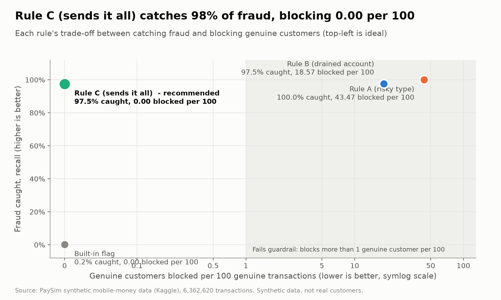
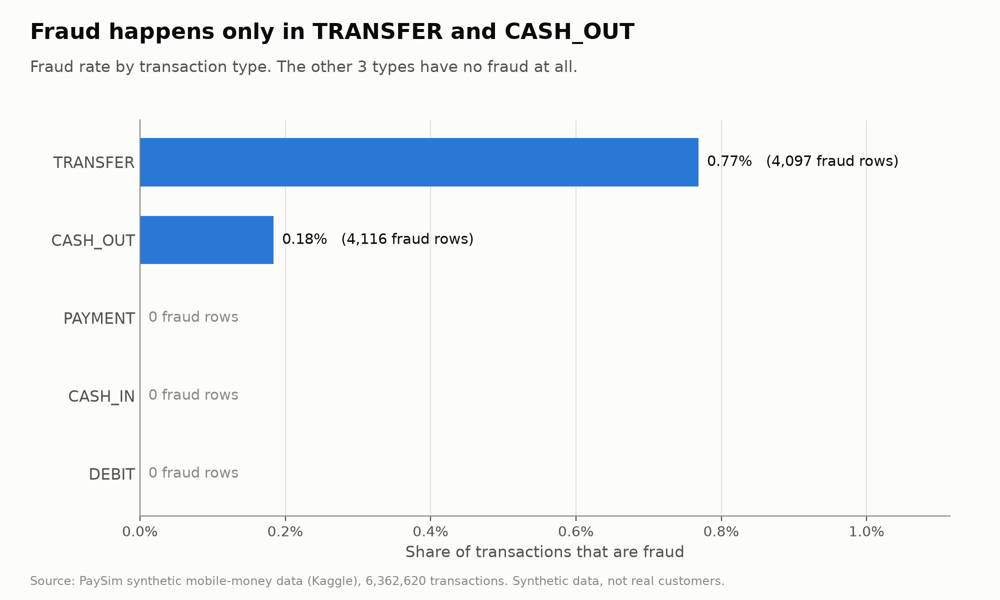
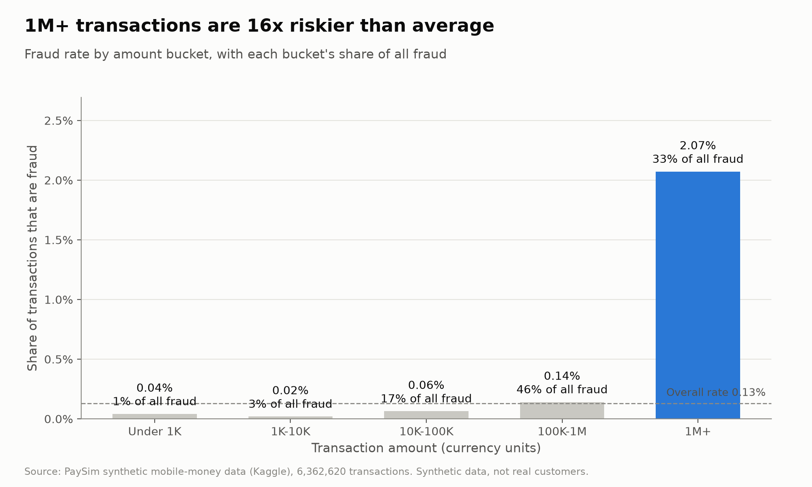
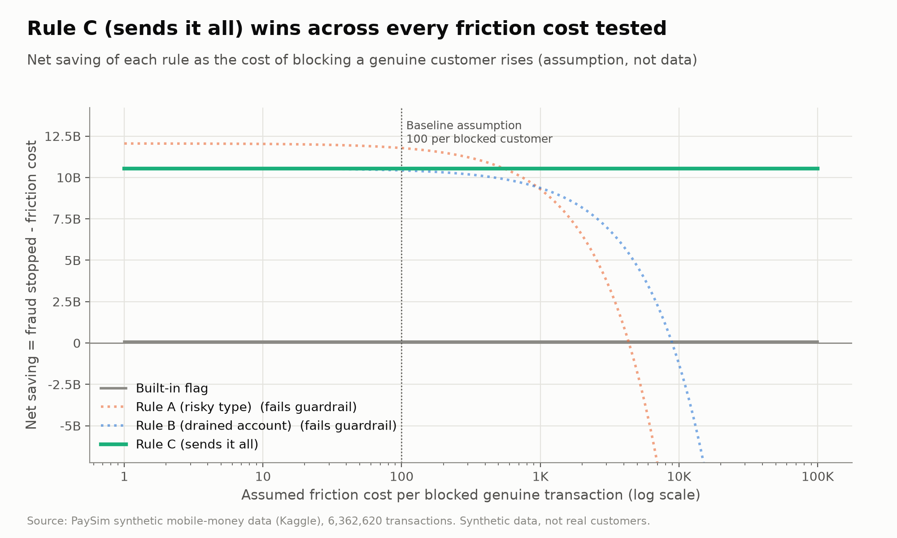
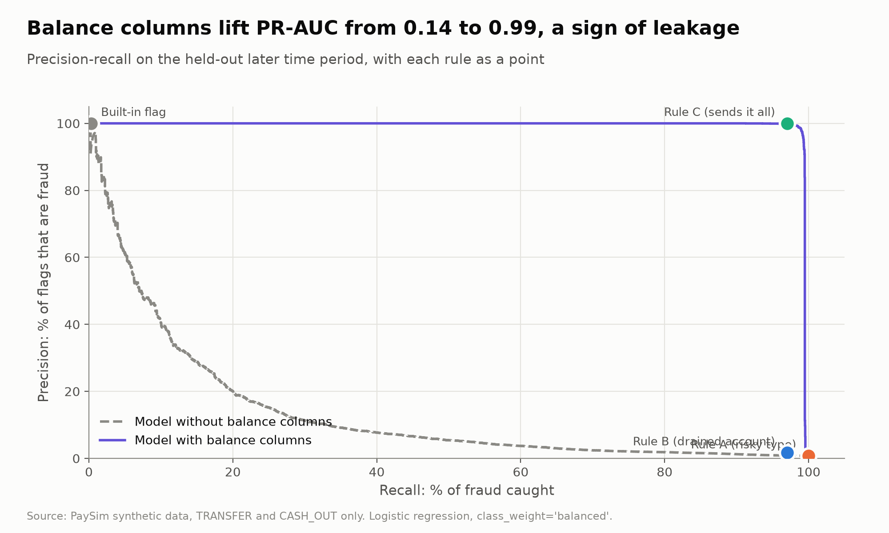

# Which fraud rule should a payments product ship?

**A rules-vs-model trade-off on 6,362,620 mobile-money transactions, analysed in SQL.**

> **Fraud is confined to TRANSFER and CASH_OUT** (100% of all fraud). **Rule C (sends it all)**, which flags *B + amount equals entire balance*, catches **97.5%** of fraud and blocks **0.00 genuine customers per 100**. It has the best net saving at every friction cost tested. The model adds **nothing** on top. On money alone Rule A (risky type) would win, but it blocks 43.5 genuine customers per 100, which fails the 1-per-100 guardrail.



| | |
|---|---|
| **Business question** | Which rule catches the most fraud without blocking genuine customers, and when does that answer change? |
| **Data** | PaySim (Kaggle), 6,362,620 **synthetic** transactions over 743 simulated hours |
| **Fraud rate** | 0.129% (8,213 rows), so accuracy is meaningless and every rule is judged on precision and recall |
| **Stack** | SQLite for all analysis, Python/Pandas for loading and charts, Matplotlib, scikit-learn for the baseline model |

---

## 1. Where fraud concentrates



- Fraud appears **only in TRANSFER and CASH_OUT**. The other types have zero fraud, so any rule can ignore them.
- **1M+** transactions have the highest fraud rate (2.07%, vs 0.129% overall).
- The built-in `isFlaggedFraud` rule flagged 16 rows and caught **0.20%** of fraud. It is close to useless.



## 2. Behaviour signals (TRANSFER and CASH_OUT only)

| Signal | Fraud | Genuine |
|---|---|---|
| Sender drained to exactly zero | 97.5% | 42.7% |
| Amount equals sender's entire balance | 97.6% | 0.0% |
| Sender balance arithmetic doesn't add up | 0.6% | 90.5% |
| Receiver balance arithmetic doesn't add up | 56.5% | 22.6% |

- Fraudsters empty the account: that is the strongest, simplest signal and the basis for Rules B and C.
- **Sequence signals don't work here.** Only 0.12% of fraud rows have an earlier transaction from the same sender (`LAG` per account), and 0.0% of fraud TRANSFERs are followed by a CASH_OUT from the receiving account. PaySim accounts rarely repeat, so "TRANSFER then CASH_OUT" can't be tracked per account.

## 3. Three rules, loose to strict

Each rule is a subset of the one before it ([`sql/04_build_rules.sql`](sql/04_build_rules.sql)), measured with `CASE WHEN` in [`sql/05_measure_rules.sql`](sql/05_measure_rules.sql).

| Rule | Logic | Flagged | TP | FP | Precision % | Recall % | Genuine blocked /100 | % fraud value caught | Net saving @ baseline | Guardrail |
|---|---|---|---|---|---|---|---|---|---|---|
| Built-in flag | isFlaggedFraud column (baseline) | 16 | 16 | 0 | 100.0 | 0.19 | 0.0 | 0.65 | 77.79M | passes |
| Rule A (risky type) | TRANSFER or CASH_OUT | 2,770,409 | 8,213 | 2,762,196 | 0.3 | 100.0 | 43.469 | 100.0 | 11.78B | fails |
| Rule B (drained account) | A + sender balance drained to zero | 1,188,074 | 8,012 | 1,180,062 | 0.67 | 97.55 | 18.571 | 87.49 | 10.43B | fails |
| Rule C (sends it all) | B + amount equals entire balance | 8,008 | 8,008 | 0 | 100.0 | 97.5 | 0.0 | 87.48 | 10.55B | passes |

## 4. Cost trade-off

**Assumptions (mine, not data):** a flagged fraud is fully stopped. Each genuine customer blocked costs a flat friction cost (baseline **100** currency units). Missed fraud costs the same under every rule, so it drops out.
**Guardrail:** a rule that blocks more than **1 genuine customer per 100** is never recommended, however much it saves on paper. Fails it: Rule A (risky type), Rule B (drained account).
`net saving = fraud stopped - genuine blocked x friction cost`



| Friction cost per blocked customer | Built-in flag | Rule A (risky type) | Rule B (drained account) | Rule C (sends it all) | Best rule (with guardrail) | Best rule (money only) |
|---|---|---|---|---|---|---|
| 1 | 77.79M | 12.05B | 10.55B | 10.55B | Rule C (sends it all) | Rule A (risky type) |
| 10 | 77.79M | 12.03B | 10.54B | 10.55B | Rule C (sends it all) | Rule A (risky type) |
| 100 | 77.79M | 11.78B | 10.43B | 10.55B | Rule C (sends it all) | Rule A (risky type) |
| 1,000 | 77.79M | 9.29B | 9.37B | 10.55B | Rule C (sends it all) | Rule C (sends it all) |
| 10,000 | 77.79M | -15.57B | -1.25B | 10.55B | Rule C (sends it all) | Rule C (sends it all) |
| 100,000 | 77.79M | -264.16B | -107.46B | 10.55B | Rule C (sends it all) | Rule C (sends it all) |


## 5. Does a model beat the rules?

Logistic regression, `class_weight="balanced"`, TRANSFER and CASH_OUT only, **time-based split** (train on steps 1-354, test on later steps: 552,504 rows, 4,258 fraud). Rules are re-measured on the same test rows.



| Method (test period only) | PR-AUC | Precision % | Recall % |
|---|---|---|---|
| Model without balance columns | 0.137 | 2.25 | 72.1 |
| Model with balance columns | 0.995 | 89.71 | 99.46 |
| Rule A (risky type) | - | 0.77 | 100.0 |
| Rule B (drained account) | - | 1.69 | 97.06 |
| Rule C (sends it all) | - | 100.0 | 97.06 |
| Built-in flag | - | 100.0 | 0.31 |

- At the same recall as Rule C (sends it all) (97.1%), the model is 99.9% precise vs the rule's 100.0% (-0.1 points). **Verdict: the model adds nothing on top of the rule - the rule is more precise.**
- Without balance columns PR-AUC is 0.137; with them it is 0.995. That jump is the leakage: in PaySim the balance columns almost encode the label.
- For a product team the rule wins on cost of ownership: it is one line of SQL, explainable to support staff and auditors, and needs no retraining.

## Recommendation

1. Ship **Rule C (sends it all)** now. It is cheap to run and easy to explain.
2. Agree the real friction cost with the product and support teams. If it is above the tested range, switch to a stricter rule.
3. Track weekly: fraud caught %, genuine blocked per 100, net saving, and alert volume.
4. Revisit a model only on real data where balances don't leak the label.

## Honest limits

- **The data is synthetic.** PaySim simulates mobile-money behaviour, so these are not real-world fraud findings.
- **The balance columns almost give away the label**, which makes any model look better than it would be in production.
- **Cost figures are my assumptions**, not real data. The sensitivity table shows how the answer moves when they change.
- Accounts rarely repeat in PaySim, so per-customer behaviour (velocity, history) can't be tested.

## Repo structure

```
sql/                  numbered queries, run in order (all core analysis is SQL)
src/load_data.py      CSV -> SQLite in chunks, with indexes
src/run_sql.py        runs sql/*.sql, saves tagged results to outputs/tables/
src/charts.py         the four charts (shared style in src/style.py)
src/model.py          optional baseline model vs rules
src/build_readme.py   writes this README from the outputs, so every number is computed
outputs/tables/       rules_comparison.csv, cost_sensitivity.csv and every query result
outputs/figures/      charts
```

## Reproduce

```bash
pip install -r requirements.txt
# download PS_20174392719_1491204439457_Log.csv from Kaggle (PaySim, by ealaxi) into data/
python run_all.py
```
